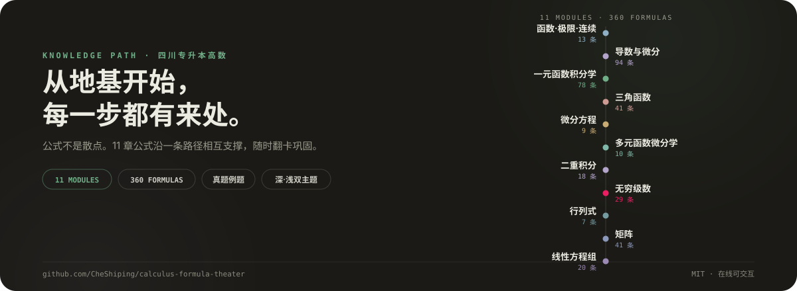
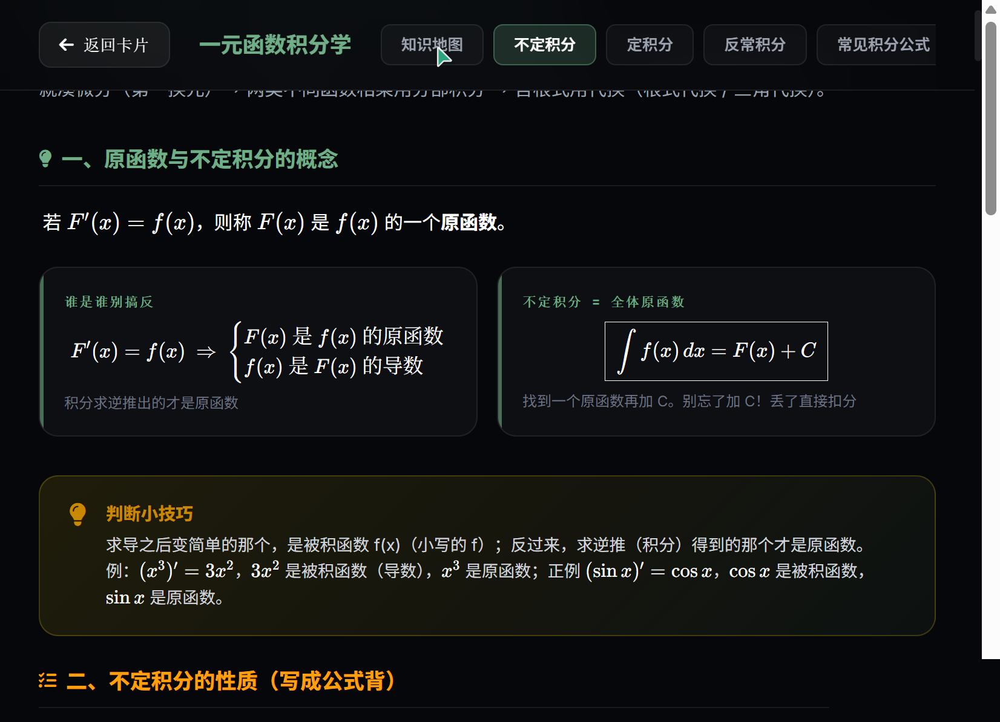
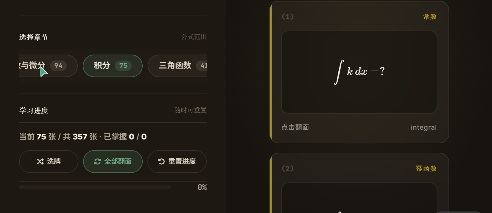
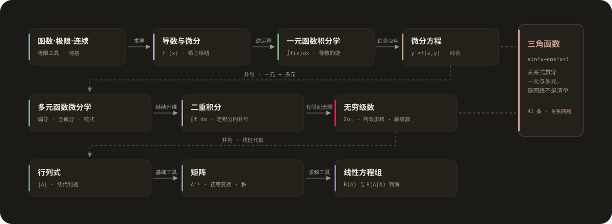
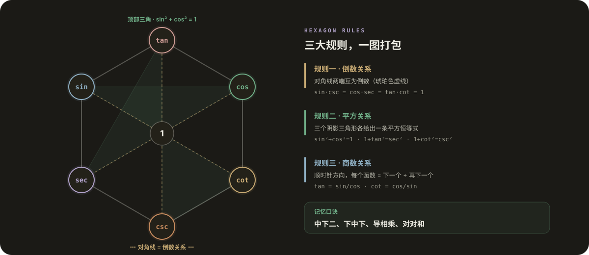

<p align="center">
  
</p>

<p align="center">
  <a href="https://cheshiping.github.io/calculus-formula-theater/"><strong>🌐 在线演示</strong></a>&nbsp;&nbsp;·&nbsp;&nbsp;
  <a href="https://cheshiping.github.io/calculus-formula-theater/review.html"><strong>🃏 翻卡记忆</strong></a>&nbsp;&nbsp;·&nbsp;&nbsp;
  <a href="./notes/00-笔记索引.md"><strong>📖 笔记目录</strong></a>&nbsp;&nbsp;·&nbsp;&nbsp;
  <a href="#-快速开始"><strong>🚀 快速开始</strong></a>
</p>

---

## 这是什么

四川专升本高数的**联动记忆系统**：把 **11 个章节、360 条公式**组织成「**知识路径 → 公式详情 → 翻卡自测**」三层结构。

- **知识路径首页** — 11 个模块按学习顺序排在一条垂直时间轴上，每个模块标注公式条数与定位（地基 / 核心枢纽 / 导数的逆……）
- **公式详情页** — 点开任一模块，公式卡按考点分组，每条配**记忆口诀**与**联动说明**，真题例题穿插其中
- **翻卡自测** — 360 张翻卡覆盖全部公式，按模块筛选，掌握状态本地保存

**适合谁**：四川专升本考生、正在学高等数学、需要把公式连成网络而不是清单的人。

> 📖 **文字版笔记**：全站内容同步整理为 Markdown 笔记（11 章），位于 [`notes/`](./notes)，从 [笔记索引](./notes/00-笔记索引.md) 进入，方便离线学习与复习。

<p align="center">
  &nbsp;
</p>
<p align="center">
  
</p>

---


### 三层结构，一个入口

| 层 | 页面 | 干什么 |
|---|------|--------|
| **1 · 知识路径** | [首页](https://cheshiping.github.io/calculus-formula-theater/) | 从「函数·极限·连续」开始，沿时间轴看清每章的来处与去处 |
| **2 · 公式详情** | 详情页（全屏覆盖层） | 每章的公式卡、口诀、真题例题、交互演示（如六边形记忆法） |
| **3 · 翻卡自测** | [翻卡页](https://cheshiping.github.io/calculus-formula-theater/review.html) | 按模块筛选翻卡自测，「标记掌握」状态存 `localStorage` |

### 联动记忆，不是堆公式

每条公式都标注它与其它章节的联动关系：

| 联动 | 说明 |
|------|------|
| 导数 ↔ 积分 | 记住 `(tan x)' = sec²x` → 自动知道 `∫sec²x dx = tan x + C` |
| 二倍角 ↔ 降幂 | `cos2α` 三种形式 ↔ `sin²x` / `cos²x` 降幂 |
| 定积分 ↔ 二重积分 | 一元算面积、二元算体积，X/Y 型、交换次序、极坐标同源 |
| 行列式 ↔ 方程组 | 行列式给判据、矩阵给工具，最终判定「有无解 / 几个解」 |

### 深色 / 浅色双主题

- 右上角一键切换，选择持久化到 `localStorage`
- 首次访问跟随系统 `prefers-color-scheme`
- 知识路径首页是「纸张 + 墨色」的文档式排版，两套主题下都适合长时间阅读

---



---


11 个模块与公式卡条数（与翻卡页数据实时同步）：

| # | 模块 | 公式卡 | 核心内容 |
|---|------|-------|---------|
| 01 | 函数 · 极限 · 连续 | 13 | 定义域、七种未定式、等价无穷小、间断点与渐近线 |
| 02 | 导数与微分 | 94 | 定义式、求导法（分段/隐函数/幂指/参数方程/变限积分）、高阶导数、应用 |
| 03 | 一元函数积分学 | 78 | 不定积分四大方法、定积分技巧与变限积分、反常积分 |
| 04 | 三角函数 | 41 | 关系式、特殊值、升降幂、六边形记忆法、诱导公式 |
| 05 | 微分方程 | 9 | 一阶（可分离/齐次/一阶线性）+ 二阶齐次/非齐次 |
| 06 | 多元函数微分学 | 10 | 偏导、全微分、链式法则、隐函数、无条件极值 |
| 07 | 多元函数积分学（二重积分） | 18 | 直角坐标 X/Y 型、交换次序、对称性、极坐标 |
| 08 | 无穷级数 | 29 | 三大基准级数、正项级数判别法、幂级数收敛域与和函数 |
| 09 | 线性代数 · 行列式 | 7 | 计算、6 条性质、展开定理 |
| 10 | 线性代数 · 矩阵 | 41 | 运算、逆与伴随、初等变换、秩 |
| 11 | 线性代数 · 线性方程组 | 20 | 齐次/非齐次求解、$R(A)$ 与 $R(A\mid b)$ 判解、解的结构 |

### 📖 Markdown 笔记镜像

| 章节 | 笔记 |
|------|------|
| 01 函数、极限、连续 | [01-函数、极限、连续.md](./notes/01-函数、极限、连续.md) |
| 02 导数与微分 | [02-导数与微分.md](./notes/02-导数与微分.md) |
| 03 一元函数积分学 | [04-一元函数积分学.md](./notes/04-一元函数积分学.md) |
| 04 三角函数 | [05-三角函数.md](./notes/05-三角函数.md) |
| 05 微分方程 | [06-微分方程.md](./notes/06-微分方程.md) |
| 06 多元函数微分学 | [07-多元函数微分学.md](./notes/07-多元函数微分学.md) |
| 07 多元函数积分学（二重积分） | [08-多元函数积分学-二重积分.md](./notes/08-多元函数积分学-二重积分.md) |
| 08 无穷级数 | [11-无穷级数.md](./notes/11-无穷级数.md) |
| 09 线性代数 · 行列式 | [09-线性代数-行列式.md](./notes/09-线性代数-行列式.md) |
| 10 线性代数 · 矩阵 | [10-矩阵.md](./notes/10-矩阵.md) |
| 11 线性代数 · 线性方程组 | [12-线性方程组.md](./notes/12-线性方程组.md) |

---




三角函数详情页内置**交互式六边形 SVG**（与上图同一几何）：

- 六个顶点 = 六个三角函数，**中心是 1**
- **对角线（琥珀虚线）** = 倒数关系
- **三个阴影三角形** = 平方关系
- 鼠标悬停顶点高亮放大

> **记忆口诀**：中下二、下中下、导相乘、对对和

---


| 技术 | 用途 |
|------|------|
| **原生 HTML/CSS/JS** | 「源码 = 产物」，无框架、无打包器 |
| [Tailwind CSS](https://tailwindcss.com/)（CDN） | 原子化样式 + 扩展色板 |
| [KaTeX](https://katex.org/)（CDN） | `$...$` / `$$...$$` 数学公式渲染 |
| **CSS 自定义属性** | 深色/浅色主题 + 纸张式排版 |
| [Font Awesome](https://fontawesome.com/)（CDN） | 图标库 |

> **公式数据流**：`index.html` 里的 `formulaCard(...)` → `scripts/extractFormulas.mjs` 抽提 → `src/data/formulas.js` → 翻卡页 `import` 自动同步。

---

## 🚀 快速开始

```bash
# 安装依赖
npm install

# 启动开发服务器（默认 http://localhost:8001）
npm run dev

# 构建产物（纯拷贝 src/ → dist/output/，不打包不改路径）
npm run build
```

> 直接用浏览器打开 `src/index.html` 也可以；但 `review.html` 用 ES module 加载公式数据，**必须走 HTTP**（用 `npm run dev` 即可）。

---

## 📁 项目结构

```
.
├── src/
│   ├── index.html          # 主应用：知识路径首页 + 各章详情页
│   ├── review.html         # 翻卡记忆页（360 张卡，按模块筛选）
│   ├── data/formulas.js    # 公式数据（脚本自动生成，勿手改）
│   └── prototypes/         # 早期设计原型
├── notes/                  # 11 章 Markdown 笔记（站点内容镜像）
├── scripts/
│   └── extractFormulas.mjs # 从 index.html 抽提公式卡数据
├── assets/readme/          # README 视觉资产（SVG + 界面截图）
├── docs/
│   └── design-system.md    # 语义化设计系统文档
├── .github/workflows/
│   └── deploy.yml          # push 到 main 自动发布 GitHub Pages
├── package.json
└── README.md
```

---

## ⭐ Star History

[](https://github.com/CheShiping/calculus-formula-theater/stargazers)
[](https://github.com/CheShiping/calculus-formula-theater/forks)
[](https://github.com/CheShiping/calculus-formula-theater/watchers)

<!-- Star History 趋势图：仓库 Star 数量达到一定值后可启用下方嵌入 -->
<!-- [](https://star-history.com/#CheShiping/calculus-formula-theater&Date) -->

---

## 📝 License

MIT
